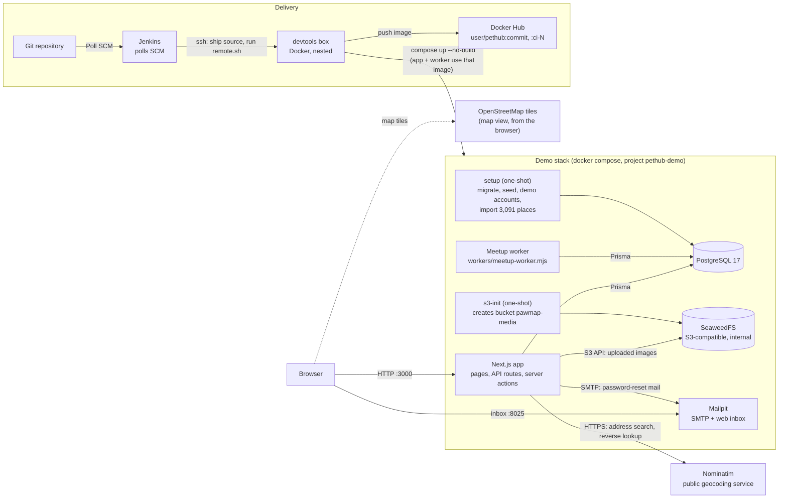
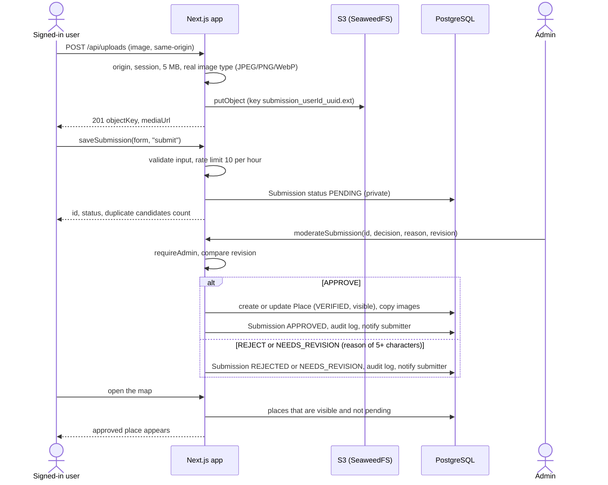
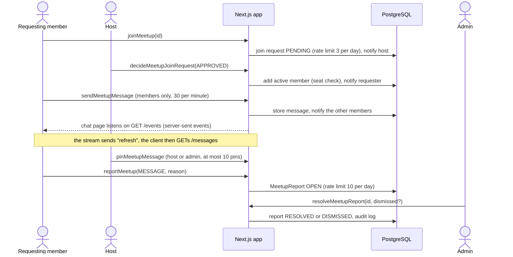

# Architecture

Source: `devtools/HANDOFF.md` (Thai) and the code. Keep this file in sync when the design changes.
Claims about failure behaviour cite the file (and test) that shows them; anything not shown in code or a
test is marked "not verified".

## Overview

PetHub finds pet-friendly places in Thailand (Thai/English). Features: 3D Thailand map and OSM street
map, place submissions, reviews, favorites, reports, Social Meetups with group chat, owned-pet health
book, avatars, and an admin moderation area. The repo ships a public snapshot of 3,091 places.

## Runtime components

The diagram shows the one-command demo stack (`devtools/infra/compose.demo.yml`, the stack the quick start
in the [README](../README.md) starts) and how the Jenkins pipeline delivers to it. The Jenkins blue/green
deployment with Nginx (`devtools/infra/compose.yml`, [ADR 0002](decisions/0002-blue-green-deploys-behind-nginx.md))
runs the same app image behind Nginx instead.

Notes on the diagram:

- Avatars are stored in PostgreSQL; place, review, submission and Meetup images go to S3
  ([ADR 0003](decisions/0003-avatars-in-postgresql-and-media-in-s3.md)).
- The app reads uploaded images back through `/api/media/...`; the browser never talks to S3 directly.
- The worker and the app share the same image (`workers/meetup-worker.mjs` runs with `node`).
- Jenkins runs no Docker itself; every Docker and npm command runs on the box
  ([`devtools/infra/ci/README.md`](../devtools/infra/ci/README.md)).

## Components

- `devtools/src/app`: routes and API (public, `/en/...`, auth, user, meetup, admin, health)
- `devtools/src/features`: UI and workflows per feature
- `devtools/src/lib`: domain, repositories, security, shared services
- `devtools/prisma`: schema, migrations, sanitized place snapshot with SHA-256 manifest
- `devtools/infra`: Compose, Jenkins, Nginx, worker and deploy scripts

## Flow 1: place submission to the public map

Code: `src/features/submissions/actions.ts` (`saveSubmission`), `src/app/api/uploads/route.ts`,
`src/features/admin/actions.ts` (`moderateSubmission`), `src/app/api/places/map/route.ts`.
Tests: `tests/integration/submission-workflow.test.ts`, `tests/integration/map-workflow.test.ts`,
`tests/e2e/submission.spec.ts`.

A submission sent back for changes can be edited and sent again; its `revision` number increases, and
`moderateSubmission` refuses a decision that carries an older revision.

## Flow 2: Meetup join, chat, pin, report, admin

Code: `src/features/meetups/actions.ts` (`joinMeetup`, `decideMeetupJoinRequest`, `sendMeetupMessage`,
`pinMeetupMessage`, `reportMeetup`, `resolveMeetupReport`), `src/app/api/meetups/[id]/events/route.ts`,
`.../messages/route.ts`, `workers/meetup-worker.mjs`.
Tests: `tests/integration/meetup-join-requests.test.ts`, `meetup-pins.test.ts`, `meetup-moderation.test.ts`,
`tests/e2e/meetups.spec.ts`.

The worker (`workers/meetup-worker.mjs`, one pass every 60 seconds) expires pending join requests of
Meetups that started or were cancelled, moves Meetups to ONGOING/COMPLETED by time, and sends the
"starting within an hour" notification once per Meetup.

## Failure behaviour

"Verified" means shown in the cited code or test. Where what the user sees was not checked, the cell says
"not verified".

| Situation                                        | What the system does                                                                                                                                                                                                          | What the user sees                                                                              | Source                                                                                                                           |
| ------------------------------------------------ | ----------------------------------------------------------------------------------------------------------------------------------------------------------------------------------------------------------------------------- | ----------------------------------------------------------------------------------------------- | -------------------------------------------------------------------------------------------------------------------------------- |
| PostgreSQL down                                  | `GET /api/health/ready` answers HTTP 503 `{"status":"not-ready"}`. The compose health check of `app` uses this URL, so the container is reported unhealthy. The worker logs the error and tries again in 60 s.                | Pages and actions that need the database: not verified.                                         | `src/app/api/health/ready/route.ts`, `infra/compose.demo.yml`, `infra/workers/meetup-worker.mjs`                                 |
| Invalid runtime configuration (production build) | Readiness answers 503 with `reason: runtime-configuration` when a required variable is missing, the auth secret is shorter than 32 characters, or a non-local URL is not https.                                               | Not applicable (operator-facing).                                                               | `src/lib/server-config.ts`, `src/app/api/health/ready/route.ts`                                                                  |
| S3 storage down (reading an image)               | `/api/media/[key]` catches the storage error and answers 404 `Not found`.                                                                                                                                                     | A missing image.                                                                                | `src/app/api/media/[key]/route.ts`                                                                                               |
| S3 storage down (uploading an image)             | `POST /api/uploads` calls `putObject` without a try/catch, so the storage error is not turned into a specific response.                                                                                                       | Not verified.                                                                                   | `src/app/api/uploads/route.ts`, `src/lib/object-storage.ts`                                                                      |
| SMTP / Mailpit down                              | `sendPasswordResetEmail` awaits the SMTP send and does not catch the error. Required SMTP variables missing throws `Required environment variable ... is not configured`.                                                     | Not verified. No automated test sends a reset mail.                                             | `src/lib/mailer.ts`, `src/lib/auth.ts`                                                                                           |
| Geocoder (Nominatim) unavailable                 | A failed or non-OK provider answer returns HTTP 503 with a Thai message asking to place the pin or pick province and district manually. Only the host `nominatim.openstreetmap.org` is ever contacted.                        | A message in the submission form; the user can still pin the place and choose the area by hand. | `src/app/api/geocode/route.ts`                                                                                                   |
| Geocoder called too often                        | More than one provider call per second returns HTTP 429. This throttle stays on when `RATE_LIMIT_DISABLED=true`.                                                                                                              | A "please wait" message.                                                                        | `src/app/api/geocode/route.ts`, `tests/unit/geocode-throttle.test.ts`                                                            |
| Meetup worker down                               | The app keeps serving. Status changes by time, expiry of pending join requests and the "starting soon" notification are done only by the worker pass, so they wait until it runs again.                                       | Not verified.                                                                                   | `infra/workers/meetup-worker.mjs`                                                                                                |
| Invalid input (forms)                            | Server actions validate with zod and return `{ ok: false, fieldErrors }` or `formError`; nothing is written.                                                                                                                  | Field or form error messages.                                                                   | `src/features/*/actions.ts`, `tests/unit/validation.test.ts`                                                                     |
| Invalid input (sign-up, reset, name)             | A Better Auth hook rejects bad email, password length (10 to 128) or display name (2 to 80) with `BAD_REQUEST` and a code such as `PASSWORD_TOO_SHORT`.                                                                       | An error message on the form.                                                                   | `src/lib/auth.ts`, `src/lib/auth-validation.ts`, `tests/unit/auth-validation.test.ts`                                            |
| Invalid upload                                   | 400 missing file, 413 over 5 MB, 415 not a real JPEG/PNG/WebP (content is checked, not the name), 409 over the per-item image limit, 403 untrusted origin, 401 not signed in or suspended.                                    | Upload error.                                                                                   | `src/app/api/uploads/route.ts`, `tests/integration/upload-security.test.ts`, `infra/scripts/smoke-demo.sh` (415)                 |
| Not signed in                                    | Pages call `requireUser`, which redirects to `/login?next=...` (`/en/login` for English). Suspended users go to `/unauthorized?reason=suspended`. API routes answer 401.                                                      | The login page, then back to the page.                                                          | `src/lib/auth-guards.ts`, `tests/e2e/auth.spec.ts`                                                                               |
| Signed in but not an admin                       | Admin pages and admin server actions call `requireAdmin`, which redirects to `/unauthorized?reason=role`. Demo-data actions refuse non-admins even when the flag is on.                                                       | The "unauthorized" page.                                                                        | `src/lib/auth-guards.ts`, `src/features/admin/admin-shell.tsx`, `tests/e2e/auth.spec.ts`, `tests/integration/demo-tools.test.ts` |
| Rate limit exceeded                              | Server actions return a `formError` (for example reviews: 5 per hour, submissions: 10 per hour). Better Auth limits sign-in to 5 per 15 minutes per client. Limits are off only when `RATE_LIMIT_DISABLED` is exactly `true`. | A message on the form. Sign-in limit response text: not verified.                               | `src/lib/rate-limit.ts`, `src/lib/auth.ts`, `tests/unit/rate-limit-switch.test.ts`                                               |

## External dependencies

PostgreSQL 17, S3-compatible object store, SMTP, Nominatim (geocoding), OpenStreetMap tiles
(attribution required), Jenkins.

## Key stack

Next.js, React, TypeScript, Prisma, better-auth, Tailwind, maplibre-gl, three.js, Vitest, Playwright.
Exact versions: `devtools/package.json`.
